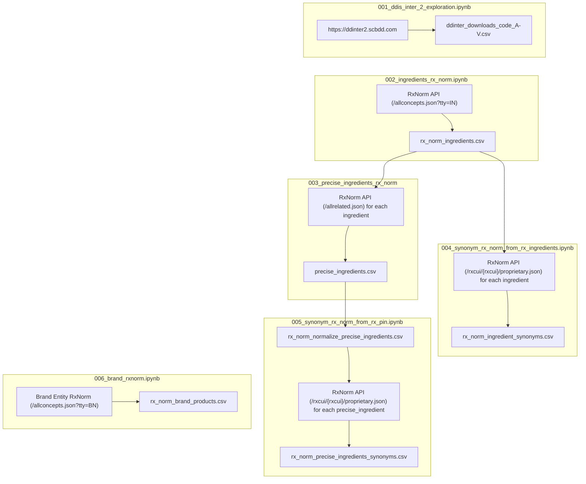

# Datasets - Data Acquisition (`../notebooks/01_acquisition/*`)

This directory contains the raw and preprocessed datasets gathered during the **Data Acquisition** phase of the Knowledge Graph-based Drug-Drug Interaction (KG-DDI) Question Answering pipeline.

---

## 🗺️ Acquisition Pipeline Architecture



---

## 📊 Summary Overview

| File Name | Generated In | Rows | Columns | Purpose |
| :--- | :--- | :--- | :--- | :--- |
| 1. [`ddinter_downloads_code_A.csv`](./ddinter2.0/ddinter_downloads_code_A.csv)<br>2. [`ddinter_downloads_code_B.csv`](./ddinter2.0/ddinter_downloads_code_B.csv)<br>3. [`ddinter_downloads_code_D.csv`](./ddinter2.0/ddinter_downloads_code_D.csv)<br>4. [`ddinter_downloads_code_H.csv`](./ddinter2.0/ddinter_downloads_code_H.csv)<br>5. [`ddinter_downloads_code_L.csv`](./ddinter2.0/ddinter_downloads_code_L.csv)<br>6. [`ddinter_downloads_code_P.csv`](./ddinter2.0/ddinter_downloads_code_P.csv)<br>7. [`ddinter_downloads_code_R.csv`](./ddinter2.0/ddinter_downloads_code_R.csv)<br>8. [`ddinter_downloads_code_V.csv`](./ddinter2.0/ddinter_downloads_code_V.csv) | `001_ddis_inter_2_exploration.ipynb` | 222,383 | 5 | Drug-Drug Interaction pairs with level (DDInter 2.0). |
| [`rx_norm_ingredients.csv`](./rx_norm_ingredients.csv) | `002_ingredients_rx_norm.ipynb` | 14,663 | 2 | RxNorm standard active ingredients (`tty=IN`). |
| [`rx_norm_master_precise_ingredients.csv`](./rx_norm_master_precise_ingredients.csv) | `003_precise_ingredients_rx_norm.ipynb` | 3,659 | 2 | RxNorm Precise Ingredients (`tty=PIN`). |
| [`rx_norm_ingredient_synonyms.csv`](./rx_norm_ingredient_synonyms.csv) | `004_synonym_rx_norm_from_rx_ingredients.ipynb` | 14,663 | 3 | RxNorm standard active ingredient synonyms (tty=`SY`, `FSY`). |
| [`rx_norm_precise_ingredients_synonyms.csv`](./rx_norm_precise_ingredients_synonyms.csv) | `005_synonym_rx_norm_from_rx_pin.ipynb` | 3,659 | 3 | RxNorm precise ingredient synonyms (tty=`SY`, `FSY`). |
| [`brand_rxnorm.csv`](./brand_rxnorm.csv) | `006_brand_rxnorm.ipynb` | 5,114 | 2 | RxNorm Brand with it's ingredients |

---

## 📁 File Specifications

### 1. `ddinter_downloads_code_A.csv`

### 2. `ddinter_downloads_code_B.csv`

### 3. `ddinter_downloads_code_D.csv`

### 4. `ddinter_downloads_code_H.csv`

### 5. `ddinter_downloads_code_L.csv`

### 6. `ddinter_downloads_code_P.csv`

### 7. `ddinter_downloads_code_R.csv`

### 8. `ddinter_downloads_code_V.csv`

- **Source Notebook:** `../notebooks/01_acquisition/001_ddis_inter_2_exploration.ipynb`
- **Source:** DDInter 2.0 ([https://ddinter2.scbdd.com](https://ddinter2.scbdd.com)).
- **Description:** Drug-drug interaction dataset containing pairwise interactions and clinical effect descriptions.
- **Schema:**
  - `DDInterID_A` (*string*): DDInter ID of the first drug.
  - `Drug_A` (*string*): First drug name.
  - `DDInterID_B` (*string*): DDInter ID of the second drug.
  - `Drug_B` (*string*): Second drug name.
  - `Level` (*string*): Clinical severity level of the interaction (e.g., 'major', 'moderate', 'minor', 'unknown').
- **Sample:**

  ```csv
  DDInterID_A,Drug_A,DDInterID_B,Drug_B,Level
  DDInter1263,Naltrexone,DDInter1,Abacavir,Moderate
  DDInter1,Abacavir,DDInter1348,Orlistat,Moderate
  DDInter58,Aluminum hydroxide,DDInter582,Dolutegravir,Major
  DDInter112,Aprepitant,DDInter582,Dolutegravir,Minor
  DDInter138,Attapulgite,DDInter582,Dolutegravir,Major
  ```

---

### 9. `rx_norm_ingredients.csv`

- **Source Notebook:** `../notebooks/01_acquisition/002_ingredients_rx_norm.ipynb`
- **Description:** Master reference dictionary of active ingredients (`tty=IN`) fetched globally from RxNorm (`/allconcepts.json?tty=IN`). Used as standardized anchor entities for normalizing drug compositions in `ddinter_downloads_code_*.csv` and also used to normalizing ingredient names in `rx_norm_brand_products.csv`.
- **Schema:**
  - `rx_cui` (*string/integer*): Standard RxNorm ingredient concept ID.
  - `name` (*string*): Standard ingredient name.
- **Sample:**

  ```csv
  rx_cui,name
  7052,morphine
  161,acetaminophen
  ```

---

### 10. `rx_norm_normalize_precise_ingredients.csv`

- **Source Notebook:** `../notebooks/01_acquisition/005_synonym_rx_norm_from_rx_pin.ipynb`
- **Description:** Master reference dictionary of precise active ingredients (`tty=PIN`) fetched globally from RxNorm (`/allrelated.json`) from every item in `rx_norm_ingredients.csv`. Used as standardized anchor entities for normalizing drug compositions in `ddinter_downloads_code_*.csv` and also used to normalizing ingredient names in `rx_norm_brand_products.csv` using precise ingredients as fallback to ingredients.
- **Schema:**
  - `rxcui` (*string/integer*): Standard RxNorm precise ingredient concept ID.
  - `rxcui_ingredient` (*string/integer*): RxCUI of the associated ingredient from `rx_norm_ingredients.csv`.
  - `name` (*string*): Standard precise ingredient name.
- **Sample:**

  ```csv
  rxcui,rxcui_ingredient,name
  1000104,1712,incobotulinumtoxinA
  1000112,6691,medroxyprogesterone acetate
  1000146,4083,estradiol cypionate
  1005920,1005921,ulipristal acetate
  ```

---

### 11. `rx_norm_ingredient_synonyms.csv`

- **Source Notebook:** `../notebooks/01_acquisition/004_synonym_rx_norm_from_rx_ingredients.ipynb`
- **Description:** Synonym dictionary of active ingredients (`tty=IN`) fetched globally from RxNorm (`/rxcui/{rxcui}/proprietary.json`). Used as standardized anchor entities for normalizing drug compositions in `db_drug_interaction.csv` and also used to normalizing ingredient names in `rx_norm_brand_products.csv`.
- **Schema:**
  - `rx_cui` (*string/integer*): Standard RxNorm ingredient concept ID.
  - `name` (*string*): Standard ingredient name.
  - `aliases` (*list-formatted string*): JSON/eval list of synonyms, brand aliases, and chemical variations retrieved from RxNorm.
- **Sample:**

  ```csv
  rx_cui,name,aliases
  7052,morphine,"['morphine', 'Morphine Sulfate']"
  161,acetaminophen,"['acetaminophen', 'Acetaminophen']"
  ```

---

### 12. `rx_norm_precise_ingredients_synonyms.csv`

- **Source Notebook:** `../notebooks/01_acquisition/005_synonym_rx_norm_from_rx_pin.ipynb`
- **Description:** Synonym dictionary of precise active ingredients (`tty=PIN`) fetched globally from RxNorm (`/rxcui/{rxcui}/proprietary.json`). Used as standardized anchor entities for normalizing drug compositions in `db_drug_interaction.csv` and also used to normalizing ingredient names in `rx_norm_brand_products.csv`.
- **Schema:**
  - `rx_cui` (*string/integer*): Standard RxNorm ingredient concept ID.
  - `name` (*string*): Standard ingredient name.
  - `aliases` (*list-formatted string*): JSON/eval list of synonyms, brand aliases, and chemical variations retrieved from RxNorm.
- **Sample:**

  ```csv
  rx_cui,name,aliases
  7052,morphine,"['morphine', 'Morphine Sulfate']"
  161,acetaminophen,"['acetaminophen', 'Acetaminophen']"
  ```

---

### 13. `rx_norm_brands.csv`

- **Source Notebook:** `../notebooks/01_acquisition/006_brand_rxnorm.ipynb`
- **Description:** RxNorm brand entities.
- **Schema:**
  - `rx_cui` (*string*): Standard RxNorm brand concept ID.
  - `name` (*string*): Standard brand name.
  - **Sample:**

  ```csv
  rx_cui,name
  1536545,4XLA Activator
  1117240,A+D Diaper Rash
  705892,A+D Original
  214907,A-Phedrin
  605082,A.E.R. Witch Hazel
  2723903,Aagylur
  1358725,Aardora Anti-Fungal Maximum Strength
  2536435,Abecma
  81507,Abelcet
  ```

---

### 14. `rx_norm_brand_products.csv`

- **Source Notebook:** `../notebooks/01_acquisition/007_brand_rxnorm.ipynb`
- **Description:** RxNorm brand entities.
- **Schema:**
  - `rx_cui` (*string*): Standard RxNorm brand concept ID.
  - `name` (*string*): Standard brand name.
  - `product_rxcui` (*string*): Standard RxNorm product concept ID.
  - `product_name` (*string*): Standard RxNorm product name.
  - `ingredients` (*list-formatted object*): Normalized list of ingredients parsed from json object string.
  - `precise_ingredients` (*list-formatted object*): Normalized list of precise ingredients parsed from json object string.
- **Sample:**

  ```csv
  rx_cui,name,product_rxcui,product_name,ingredients,precise_ingredients
  1536545,4XLA Activator,1536549,lactic acid 25 MG/ML Topical Solution [4XLA Activator],"[{'rx_cui': '114202', 'name': 'lactate', 'tty': 'IN'}]","[{'rx_cui': '28393', 'name': 'lactic acid', 'tty': 'PIN'}]"
  1117240,A+D Diaper Rash,1117243,dimethicone 10 MG/ML / zinc oxide 100 MG/ML Topical Cream [A+D Diaper Rash],"[{'rx_cui': '11423', 'name': 'zinc oxide', 'tty': 'IN'}, {'rx_cui': '324072', 'name': 'dimethicone', 'tty': 'IN'}]",[]
  705892,A+D Original,705895,lanolin 0.155 MG/MG / petrolatum 0.534 MG/MG Topical Ointment [A+D Original],"[{'rx_cui': '6227', 'name': 'lanolin', 'tty': 'IN'}, {'rx_cui': '8091', 'name': 'petrolatum', 'tty': 'IN'}]",[]
  214907,A-Phedrin,1099310,pseudoephedrine hydrochloride 6 MG/ML / triprolidine hydrochloride 0.25 MG/ML Oral Solution [A-Phedrin],"[{'rx_cui': '10849', 'name': 'triprolidine', 'tty': 'IN'}, {'rx_cui': '8896', 'name': 'pseudoephedrine', 'tty': 'IN'}]","[{'rx_cui': '71534', 'name': 'triprolidine hydrochloride', 'tty': 'PIN'}, {'rx_cui': '91168', 'name': 'pseudoephedrine hydrochloride', 'tty': 'PIN'}]"
  ```

---
